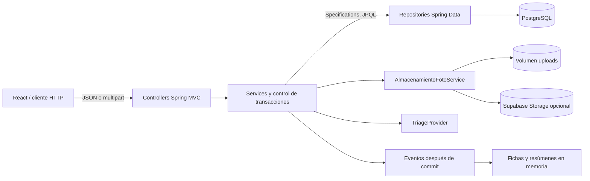
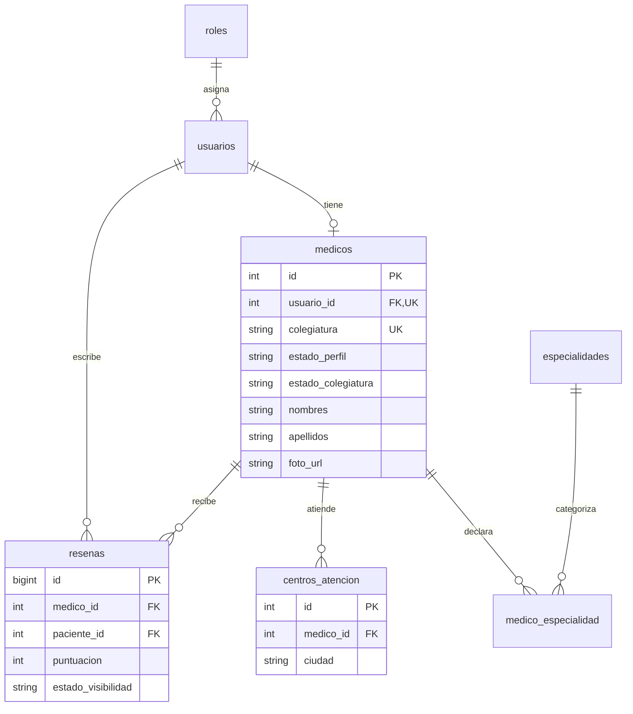

# Requisitos, brechas y arquitectura

El alcance académico se define en la [wiki de requisitos](https://github.com/AxelNick/Directorio-Medico-Inteligente/wiki/Requisitos-del-Sistema) y la [planificación de sprints](../sprints-planning.md). El plan de correcciones por integrante, págs. 2–4 y 11–12, especifica las ocho tareas y los acuerdos de integración.

## Línea base del 26 de noviembre de 2026, Lima

Rama `codex/integrante-1` y `origin/main` coincidían en `5e1b763694a15d3468d742d5b6c97c60fa1cb955` tras `git fetch origin`. No había ramas de seguimiento remoto con commits sin integrar en esa base. Se construyeron la SPA y Spring con Docker Desktop y PostgreSQL 15.19. El catálogo y la SPA respondían. Las rutas nuevas dieron 401 sin JWT y 404 con JWT para las consultas verificadas. El médico de base pudo tener un centro y una especialidad con ambos campos de identidad nulos.

| Tarea o historia | Observación y evidencia de la base | Propietario y cambio mínimo |
| --- | --- | --- |
| 1. US-MED-02/03 · identidad | Columnas `nombres` y `apellidos` ya presentes por el PR #17. `/auth/register` creaba un médico con ambos campos nulos y edición sin captura. | I1 completa formulario, DTO y servicio. I3 conserva los estados moderados. |
| 2. US-MED-02 · fotos | Volumen `uploads` y URL relativa existentes. Validación basada en tipo declarado y borrado previo al commit. | I1 valida contenido y tamaño, mueve limpieza al resultado de la transacción y agrega almacenamiento de objetos. |
| 3. US-PAC-03 · búsqueda | `MedicoRepository` ofrecía consultas de autogestión y moderación. GET público de React devolvía 401 y con JWT, 404. | I1 añade `JpaSpecificationExecutor`; I2 conserva el cliente y sus filtros. |
| 4. US-PAC-04 · ficha | Pantalla de React implementada y ensayada con mock. El backend carecía del controlador público. | I1 agrega el recurso y DTO sin usuario. I4 conserva el router. |
| 5. US-PAC-01/02/05 · triage | Existían `EmergencyDetectionService`, `TriageFallbackService` y chat, con API pendiente. | I1 conecta servicio y controlador. I3 e I4 conservan reglas, alertas y acceso manual. |
| 6. Sprint 4 · Adapter y Factory Method | Sin producto para traducir la solicitud de triage a un proveedor. | I1 agrega interfaz, adaptador y creadores seleccionados por configuración. |
| 7. US-PAC-06/07 y US-MED-06 · reputación | Entidad, restricción UNIQUE y moderación del PR #17. Consultas públicas y privadas de React devolvían 404 con JWT. | I1 añade POST/GET y promedio en PostgreSQL. I2 e I4 conservan reseñas y panel. |
| 8. Sprint 5 · Observer | Moderación registraba auditoría; el directorio no tenía caché. | I1 emite eventos en creación y moderación, actualiza reputación e invalida fichas tras commit. |

## Criterios de aceptación por historia

| Requisito de la wiki / US | Dado, cuando y entonces | Caso de control y prueba |
| --- | --- | --- |
| RF-MED-01/02/03 · identidad y CMP | Dado un médico nuevo, cuando se registra con nombre y apellidos, entonces el mismo dato se muestra al moderador y en la ficha una vez publicada. Dado el perfil antiguo, cuando completa la identidad desde su sesión, entonces conserva ID, centros y especialidades. | Nombre vacío, pareja incompleta y correo como nombre se rechazan. [Pruebas y persistencia](informe.md). |
| RF-MED-02 · fotos | Dado un perfil autorizado, cuando sube o reemplaza una foto, entonces la nueva URL sirve los bytes y sigue funcionando al recrear la API. | Archivo con MIME falseado y archivo de más de 1 MiB devuelven 400. [HTTP y navegador](../../frontend/scripts/verify-api.mjs). |
| RF-PAC-03/04 · directorio y ficha, US-PAC-03/04 | Dados varios centros y especialidades, cuando una persona combina filtros, entonces PostgreSQL devuelve una sola fila por médico y pagina con total estable. | Aprobación sola y suspensión devuelven 404 por ID. [Especificaciones](../../backend/src/main/java/pe/edu/uni/backend/repository/DirectorioSpecifications.java). |
| RF-PAC-001/02/05 · US-PAC-01/02/05 | Dado un término de catálogo activo, cuando el proveedor lo reconoce, entonces el backend guía al directorio. Ante alerta local, el proveedor tiene cero llamadas. | Salida inválida o fallo del proveedor produce fallback HTTP 200. [Pruebas de servicio](../../backend/src/test/java/pe/edu/uni/backend/service/TriageServiceTest.java). |
| RF-PAC-06/07 y RF-MED-06 · US-PAC-06/07 y US-MED-06 | Dado un JWT de paciente, cuando se reciben dos POST concurrentes para el mismo médico, entonces hay un 201, un 409 y una fila. Al aprobar, ficha, filtro, reseñas y panel coinciden. | Médico y administrador reciben 403 al calificar. Con reseñas ocultas hay total cero y promedio nulo. [Prueba HTTP](../../frontend/scripts/verify-api.mjs). |
| Sprint 5 · Observer | Dada la ficha precalentada, cuando se confirma la ocultación, entonces se recalculan los valores consultados y cambia la ficha. | Si la transacción revierte, ambos estados de caché se conservan y el valor confirmado permanece visible. [Prueba de transacción](../../backend/src/test/java/pe/edu/uni/backend/service/OnCommitResenasTest.java). |

El médico administra su perfil y consulta su reputación. El paciente consulta datos publicados y reseña con su sesión. El administrador decide por separado la publicación y la verificación de CMP y modera las reseñas con auditoría. El triage recibe texto transitorio y emite orientación operativa. Los textos libres que devuelve el proveedor se descartan. En la demo, todas las operaciones se aplican al mismo perfil ficticio y se prueba un segundo médico pendiente.

## Rúbrica

| Criterio | Qué se acredita y cómo |
| --- | --- |
| 1. Pruebas y colaboración | I1 prueba persistencia y reglas. I2 aporta cliente y pantallas desde `182e89b`, I3 moderación, resiliencia y OpenAPI desde `f4b7083` y el [PR #17](https://github.com/AxelNick/Directorio-Medico-Inteligente/pull/17), e I4 router, paneles y QA, incluido el [PR #20](https://github.com/AxelNick/Directorio-Medico-Inteligente/pull/20). Riesgos prioritarios duplicados concurrentes, filtrado de perfiles privados y respuestas clínicas impropias. |
| 2. Dominio | Roles separados, CMP verificada, ficha aprobada, catálogo activo, reseña moderada y alerta sin invocación externa. |
| 3. Requisitos | Tabla Dado/Cuando/Entonces y casos de control de esta página, con [matriz histórica y validación actual](../matriz-aceptacion-sprints-3-5.md). |
| 4. API REST | GET público filtrado, POST de reseña y PATCH moderado con Bearer. [Contrato real y ejemplos](../api-contracts.md). |
| 5. Diseño | Capas, claves y cardinalidades abajo. [Adapter, Factory Method y Observer](../patrones-diseno.md). |
| 6. Cobertura | JaCoCo de todo el backend, umbral y tasas de aceptación por separado. [Informe](informe.md). |
| 7. Documentación y pruebas | Comandos, fixtures, resultados, matrices A/B/C/D/U y R con fecha y base. [Informe](informe.md). |
| 8. Presentación | Guion cronometrado, fallo controlado, recuperación y evidencias locales. [Guion](guion.md). |
| 9. Interfaz | Recorrido SPA con navegador, escritorio y 375 px, foco, teclado, alerta, fallback y reintento. [Playwright](../../frontend/scripts/api-real.spec.mjs). |
| 10. Persistencia | UNIQUE en PostgreSQL, FK, promedio visible y SHA-256 de la foto al recrear. [SQL reproducible](persistencia.sql). |

## Diseño por capas

`resenas` tiene además UNIQUE compuesto en `(paciente_id, medico_id)`, un índice por médico y visibilidad y una FK por relación. La auditoría guarda actor y objetivo como texto histórico. El URL de foto referencia un objeto externo a la fila del médico. Spring Security resuelve el actor desde el JWT en la cabecera; cada respuesta pública se construye con DTO.

## Decisión sobre esquema

El [commit 4200fd0](https://github.com/AxelNick/Directorio-Medico-Inteligente/commit/4200fd0) eliminó Flyway y fijó Hibernate como mecanismo vigente. Hibernate `ddl-auto=update` evoluciona el esquema y `DatosIniciales` siembra roles y catálogo. Las columnas de identidad admiten nulos para conservar perfiles antiguos. La transformación de identidad la realiza el titular mediante `PUT /medicos/me/perfil` sobre su registro, con ambos campos completos y sin usar su correo como nombre público. Si el profesor exige Flyway por nombre, debe confirmar el cambio de estrategia del equipo, incluida la creación de una línea base versionada y la sustitución de `update` por validación de esquema.
